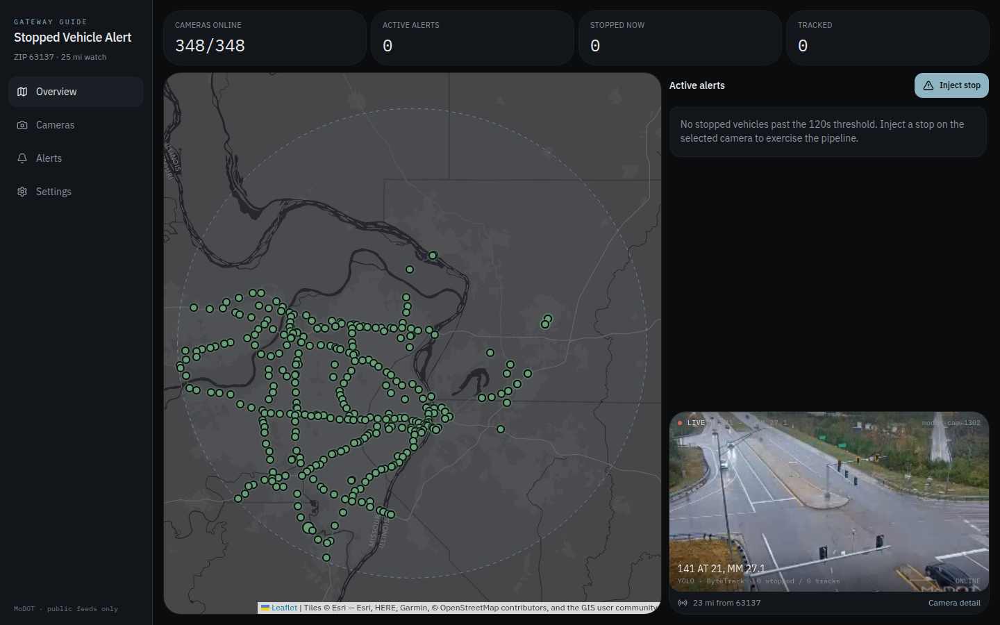
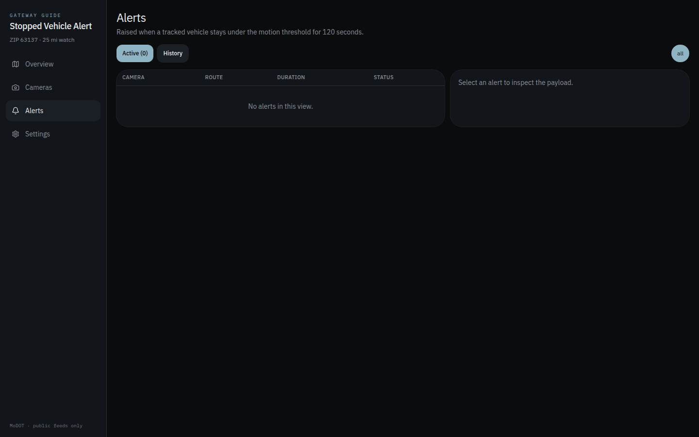
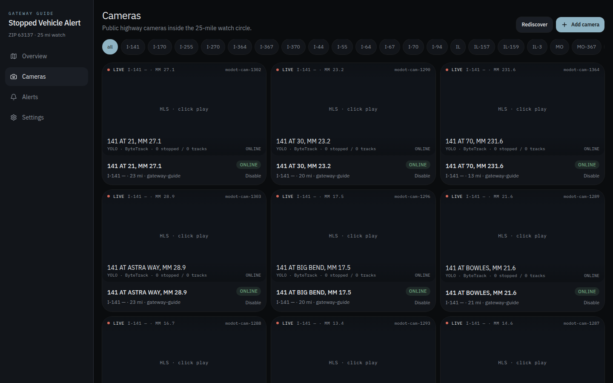
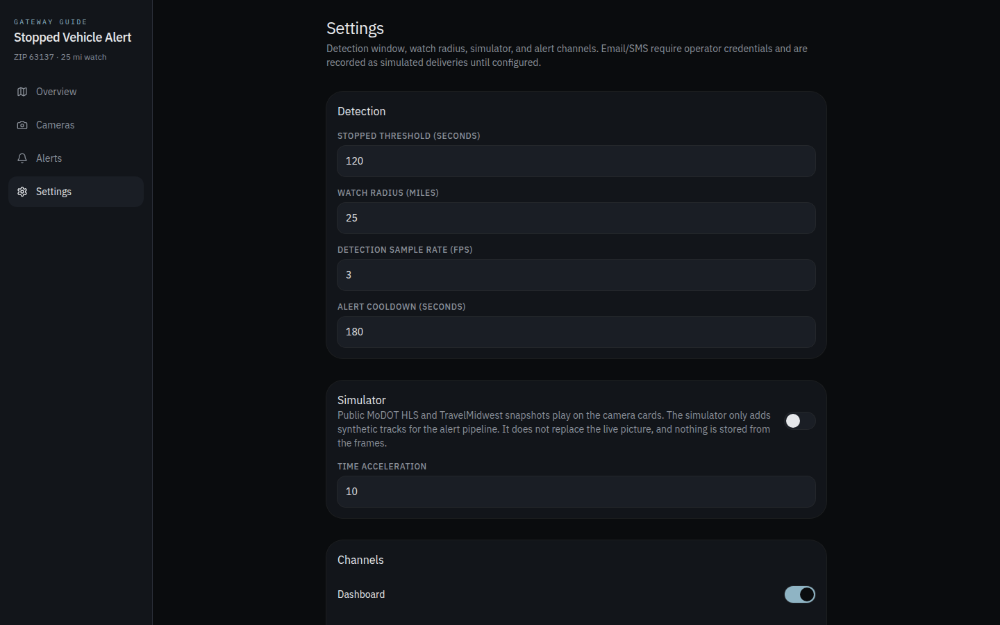

# StoppedVehicleAlert

Operations console for public highway cameras within 25 miles of ZIP **63137** (Bellefontaine Neighbors / north St. Louis County). The watch circle covers I-270, I-70, I-64/US-40, I-44, I-55, I-170, I-255, MO-370, and nearby state routes.

## Screenshots

| Dashboard | Alerts |
| --- | --- |
|  |  |

| Cameras | Settings |
| --- | --- |
|  |  |

## What it does

1. Loads Gateway Guide camera geometry (and optional Illinois TravelMidwest discovery).
2. Runs a stopped-vehicle pipeline: detect → track → sliding-window motion → duration vs threshold.
3. Raises alerts with camera, highway, mile marker, map link, duration, and confidence.
4. Shows a map, live CCTV-style feeds, active alerts, and history.

MoDOT live HLS is partnership-gated (see MoDOT EPG 910.6). This app ships a **simulator** on the real camera lattice so the workflow can be tested without bypassing source terms, storing faces, or storing plates.

## Pipeline

```
cameras → ingest / simulator → YOLO-style boxes → ByteTrack IDs
        → displacement window → stop classifier → alerts → dashboard + channels
```

Default threshold: **120 seconds**. Simulator time acceleration makes that observable in a few wall-clock seconds. **Inject stop** plants a truck already near the threshold so an alert lands almost immediately.

## Running locally

Requires Node 20+ (developed on Node 22). The database is embedded (PGlite) — no external database server.

```bash
npm install
npm run db:migrate
npm run dev            # http://localhost:8080
npm run typecheck      # tsc --noEmit
npm run test           # node test runner
```

Authentication is disabled by default (`VITE_AUTH_ENABLED=false` in `.app-env.json`), so the console opens directly on the dashboard.

## REST

| Method | Path | Purpose |
| --- | --- | --- |
| GET | `/health` | Service health |
| GET | `/api/cameras` | Cameras in radius |
| POST | `/api/cameras` | Add a camera |
| GET | `/api/alerts/active` | Open alerts |
| GET | `/api/alerts/history` | Recent alerts |
| POST | `/api/alerts/config` | Update alert config |

The dashboard refreshes operations state every two seconds.

## Data sources and attribution

| Source | Use | Access |
| --- | --- | --- |
| MoDOT Traffic Cameras (ArcGIS, `jWXb6JPWtBjOCalT`) | Camera geometry | Public feature service, queried live |
| TrafficCamerasTM Public (ArcGIS, `aIrBD8yn1TDTEXoz`) | Camera geometry | Public feature service, queried live |
| Illinois TravelMidwest | Optional discovery | Public snapshots |
| Esri World Dark Gray Base (Canvas) | Map tiles | © Esri, HERE, Garmin, © OpenStreetMap contributors, and the GIS user community |

Camera data is queried from the operators' public services at runtime. **No camera data is redistributed in this repository**, and no API key or account is required. MoDOT live HLS streams are partnership-gated and are not proxied — the simulator stands in for them.

**Attribution:** the Esri basemap requires visible credit. The map renders Leaflet's attribution control with the full Esri credit line — "Tiles © Esri — Esri, HERE, Garmin, © OpenStreetMap contributors, and the GIS user community" — on every view (see `src/components/map/traffic-map.tsx`). No API key is required for these tiles.

## Legal

Public metadata and snapshots only. No auth bypass. No face/plate archive. ROI is the travel lanes. This project is not affiliated with or endorsed by MoDOT or the Illinois Department of Transportation.

## License

MIT — see [LICENSE](LICENSE).
